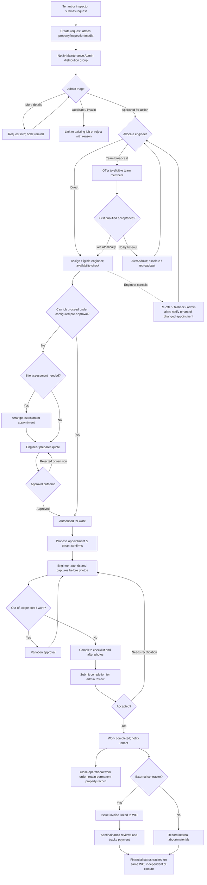

# INSPECT360 — MAINTENANCE REQUEST TO CLOSED WORK ORDER
## Cursor Pro Implementation Specification | v2.0 | 20 November 2026

> **Developer instruction:** Implement this workflow inside the **existing Inspect360 application**, using the current technology stack, authentication, RBAC, property records, tenant portal, inspector app/PWA, notifications, scheduling, inspection records and maintenance features where they already exist. **Do not create parallel modules, duplicate property/tenant tables, replace existing architecture or invent new integrations.** Audit current code and database before changing anything. Treat route names and table names below as suggested names to map to the existing codebase, not mandatory replacements.
>
> **UI reference:** `Inspect360_Maintenance_Screen_Prototype.html` contains the four requested screen mockups. They are demonstrative designs, not a backend implementation. Match the existing Inspect360 design system and the attached reference screenshot closely. Do not import a new theme or replace application-wide components.
>
> **Illustrative demo:** A tenant reports a leaking kitchen sink at `39 Park Avenue, Potters Bar EN6 5NL`, job `WO-2026-0142`. Every person, address, number and amount in the prototype is sample data only.


## 0. Inspect360 UI design contract — MANDATORY (updated v2)

### 0.1 Authoritative visual reference and priority

The user-supplied screenshot `Inspect360_HMO_Overview_UI_Reference.png` shows the **existing Inspect360 HMO overview interface**. It is the **visual style reference**, not a new workflow requirement or an instruction to copy HMO data onto maintenance pages. All four screens — quotation, contractor invoice, completion checklist/photos and final work order — **must look native to that screenshot**.

**Implementation priority:** (1) inspect the live Inspect360 app and reuse its existing component library/CSS tokens, header and navigation shell; (2) compare against the reference screenshot; (3) use `Inspect360_Maintenance_Screen_Prototype.html` and `screens/*.png` as faithful **layout examples**. The HTML reference is a standalone **design prototype**, not production code. Do not create a second application shell, add a duplicate sidebar, or invent a parallel visual system. Where the screenshot and live UI differ, use live tokens and component implementation while preserving the design intent; flag material differences for approval.

### 0.2 Screenshot-derived style characteristics

| UI element | Expected appearance | Implementation rule |
|---|---|---|
| Left navigation | White sidebar around 230px wide; small teal square `i` mark + dark `inspect` / teal `360`; subtle section headings `WORKSPACE`, `MANAGEMENT` | Reuse the **current existing Inspect360 sidebar** including Dashboard, Properties, Inspections, Compliance, Maintenance, Work orders, Reports and Settings; active item has pale mint fill and teal text/icon. |
| Global header | White top toolbar (~68px), breadcrumb left, Help / Notifications / small circular user avatar right | Reuse current header; no custom maintenance-only header. |
| Main canvas | Very pale blue-grey / grey-blue background, generous 30–35px content padding | Maintain standard Inspect360 max-width/breakpoints. |
| Text | Deep blue-grey titles; muted blue-grey subtitles, labels and metadata | Use app font and existing heading scales; h1 typically ~28px in reference. |
| Cards | Flat white blocks, thin cool-grey outline, ~10px rounded corners; small or no shadow | White grouped cards and four summary KPI cards where useful; avoid thick shadows. |
| Primary actions | Solid teal/turquoise with white text; modestly rounded corners | E.g., `Approve quotation`, `Submit for review`, `Approve invoice`. Always permission-gated. |
| Secondary actions | White background, grey-blue outline and dark blue-grey text | E.g., `Save draft`, `Request changes`, `View work order`. |
| State tags | Compact badges with subtle amber/teal/grey fills | Ambers for awaiting review/approval; green for verified; neutral for not started. Do not imply legal compliance from colour alone. |
| Attention notice | Pale warm amber panel with soft border, icon at left, key next step at right | Used for quote approval and invoice review; avoid red emergency styling for routine work. |
| Prototype marker | Pale-blue low-contrast dashed banner with label `Interactive design concept` and switcher | **Design prototype only** — should not be deployed as a banner to production users. |
| Image handling | Neat photo grid with labels BEFORE / AFTER, upload state and timestamps | Photos are evidence; do not show decorative property images in place of actual uploaded assets. |

**Approximate visual-reference colours only (not canonical app tokens):** primary teal `#00AAA6`, mint active nav `#E4F8F5`, page background `#F4F8FA`, navy text `#1B3346`, borders `#DFE9ED`, muted metadata `#8196A5`, amber panel `#FFF8ED`. The developer must inspect actual design tokens and replace these approximations with existing values rather than hardcode them globally.

**Do not reproduce:** the floating chat/voice overlay at the bottom of the screenshot; it is **not Inspect360 application UI**. No dark navy left sidebar, extraneous gradients, redesigned branding, large pill buttons, or unrelated dashboard styles.

### 0.3 Screen-by-screen hierarchy and layout

1. **Quote (`quote_screen.png`)** — breadcrumb `Properties > 39 Park Avenue > Maintenance > Quotation`; heading and status; approval notice; four KPI tiles (quote, property, engineer, estimated total); two-column content with itemised quote/scope on left and approval route + linked work order on right. Allow responsive one-column layout.
2. **Invoice (`invoice_screen.png`)** — header and awaiting-review notice; four KPI tiles (invoice status, approved quote, invoice amount, payment status); editable invoice details/lines to left; three-way quote-work-invoice verification, payment progress and supplier/property reference to right.
3. **Completion (`completion_screen.png`)** — engineer-facing report with assigned job context; four KPI tiles (job state, engineer, appointment, evidence count); task checklist and required image upload groups, supporting materials/time and submission validation. Production PWA must fit a 390px viewport without horizontal scrolling.
4. **Final work order (`record_screen.png`)** — permanent property-linked reference and two independent status areas; KPI tiles and linked document cards; left main content for fault/resolution, evidence and connected assets, right for immutable event timeline and financial status.

The visual examples intentionally retain the illustrative sink-leak scenario and example property `39 Park Avenue, Potters Bar EN6 5NL` to align with the HMO screenshot's property header. **This address is demo data**, not evidence of an actual tenancy, outstanding repair or quote.

### 0.4 UI behaviour and testing

- Use semantic components, keyboard navigation, visible focus, form labels, proper validation, loading/error/empty states; target WCAG 2.2 AA.
- Do not let quotation `Approve`, invoice `Approve`, or completion `Submit` simulate success in production. Wire them to server-side authorised actions and handle failures transparently.
- Currency and tax labels are demonstration data; calculate totals server-side using organisation/contractor tax configuration; never hardcode a 20% VAT assumption.
- Keep work-order context, property breadcrumb and statuses consistent across all four screens; engineer, Admin and tenant get **role-scoped** variants.
- Screens must handle empty photo sets, quote revision history, rejected invoices, overdue alerts, engineer cancellation and reopened cases without layout breakage.
- Screenshot regression snapshots at **1564×960 desktop** and **390×844 mobile** for quote, invoice, completion and record; compare against new UI mockups and the supplied HMO reference. Document any deliberate differences.
- The light-blue prototype ribbon and locally simulated status changes are **only for visual review**; they are not part of the production UI.

### 0.5 Design acceptance gate

A maintenance page is **not complete** when only its functionality works. The developer must show all four screens running **inside the existing Inspect360 app shell**, confirm they visually match the HMO overview styling, and verify responsive layout and RBAC. Product owner sign-off is required before removing the design QA task.

## 1. What the finished feature must achieve

A tenant or inspector reports a maintenance issue once. An authorised Maintenance Admin triages it, allocates an appropriate engineer directly or via a team-availability broadcast, obtains any required quotation approval, schedules a tenant-confirmed visit, verifies the completed work and records the full trail against the property. External contractors may submit invoices against the completed work. The maintenance record remains visible for future inspections, check-outs, compliance reviews and property history.

**Non-negotiable outcomes:**
- One request -> one primary work order -> linked quotes, appointments, images, completion checklist, invoices, notes, decisions, audit events. Support multiple quote versions, appointments and follow-up visits where needed.
- Tenant, inspector, Admin, engineer/contractor and finance each have appropriate, **different** permissions and views.
- Team allocation is race-safe: only one eligible engineer may win an offer, even under simultaneous acceptance.
- All transitions enforce guards on the **server**, never only in UI.
- Job execution is prevented until authorised, except a separately logged, permitted emergency override.
- Completion and financial status are tracked separately; a job may be operationally closed while its invoice remains unpaid.
- Existing inspection, room, asset, property, tenant and compliance records must be referenced, not copied.

### In scope
Tenant + inspector reporting; admin distribution group; AI-assisted triage (optional advisor only); direct/team assignment; first-qualified-accepts; cancellation/reallocation; quote versioning and approval; scheduling and tenant confirmation; engineer start and finish; evidence and checklist; admin completion verification; external contractor invoice submission, approval and payment tracking; full property record; notifications; reporting; permissions and audit.

### Out of scope for v1
Bank payments, payroll, automatic financial postings, full accounting ledger, automatic safety determinations, autonomous approval by AI, contractor marketplace sourcing, or new third-party integrations unless already supported. Optional Fixflo sync must be feature-gated and follow current integration patterns.

## 2. End-to-end process flow



**Interpretation:** Quote approval is **before authorised works**, but an assessment visit may occur beforehand. Tenant appointment notifications occur only after a date/window and engineer have been confirmed. Invoices come after work acceptance for external contractors. For emergencies, documented emergency policy can override normal quote timing, never safety controls.

## 3. Roles and access control

| Role | Can do | Cannot do |
|---|---|---|
| Tenant | Report issue, attach own evidence, read their job status, respond to visit proposal, message permitted contacts, report unresolved work | See internal pricing, supplier bank details, private admin notes, other tenants' jobs, arbitrary engineer contact details |
| Inspector | Create request from an inspection point; link captured photos and observations; see relevant follow-up | Approve spend or view unrelated tenants/jobs |
| Maintenance Admin | Triage/merge, classify urgency, assign, broadcast, override with reason, approve within threshold, schedule, review completion, manage invoice workflow | Exceed own approval limits, conceal audit events |
| Maintenance Engineer (employee) | View assigned jobs, accept/decline offers, quote if permitted, record time/materials, schedule/attend, upload evidence/checklist | Approve own quotation, view unassigned private jobs, generate external-contractor payable invoice |
| External Contractor | Equivalent assigned job workflow, submit quote and, after accepted completion, invoice | View unrelated property/tenant data or approve own invoice |
| Finance / Approver | Approve assigned financial steps, view invoice queue and payment status, export | Change maintenance evidence without permission |
| Eco/System Admin | Configure teams, templates, thresholds, roles, notification defaults and audit views | Bypass tenant isolation or alter immutable audit entries |

Enforce permissions with existing organisation/portfolio/property scoping. Contractor access should expire/restrict after job closure; retain access to their own approved invoices per existing policy.

## 4. Core process stages and transition guards

Use a structured **work order lifecycle**, not a single flat list of strings for every function. Keep separate dimensions:

- `request_status`: `new`, `awaiting_info`, `accepted`, `rejected`, `merged`.
- `work_status`: `awaiting_allocation`, `offered`, `assigned`, `assessment_required`, `awaiting_quote`, `awaiting_approval`, `authorised`, `awaiting_appointment`, `scheduled`, `in_progress`, `awaiting_completion_review`, `rectification_required`, `completed`, `closed`, `on_hold`, `cancelled`, `reopened`.
- `financial_status`: `not_applicable`, `not_invoiced`, `invoice_draft`, `invoice_submitted`, `invoice_queried`, `invoice_approved`, `sent_for_payment`, `part_paid`, `paid`, `void`.
- `priority`: `emergency`, `urgent`, `routine`, `low` (configurable labels and response times).

| From -> To | Actor | Mandatory guard / server action |
|---|---|---|
| Request `new` -> `accepted` | Admin | Valid property/tenant scope; record priority and triage; create/link work order; issue event |
| `awaiting_allocation` -> `offered` | Admin | Team has eligible, active, qualified members; create expiring offers |
| `offered` -> `assigned` | Engineer | Transactional compare-and-swap, unexpired offer, schedule and qualification checks; invalidate all other offers |
| `awaiting_allocation` -> `assigned` | Admin | Direct-assign permissions, engineer active/qualified; accept or confirm according to business rule |
| `assigned` -> `awaiting_approval` | Engineer | Quote present, positive totals, itemisation, quote version; create approval request |
| `awaiting_approval` -> `authorised` | Approver | Correct approval rights, amount <= limit, not self-approval; audit identity/timestamp; approved quote version locked |
| `assigned` -> `authorised` | Admin/System | Applicable pre-approved scope and spending threshold or recorded emergency exception |
| `authorised` -> `scheduled` | Admin/Engineer + tenant | Confirmed engineer, start/end slot, tenant confirmation or explicit permitted access exception |
| `scheduled` -> `in_progress` | Engineer | Authorised, assigned, time/access checks or logged override; work-start event |
| `in_progress` -> `awaiting_completion_review` | Engineer | Mandatory checklist, required photos and safe upload completion; variation approvals in place |
| `awaiting_completion_review` -> `completed` | Admin | Evidence reviewed, reason/acceptance event logged, tenant completion notice |
| `awaiting_completion_review` -> `rectification_required` | Admin | Rework reason and notification; assign corrective visit |
| `completed` -> `closed` | Admin/System | Operational closure rules; financial status continues independently |
| `completed/closed` -> `reopened` | Tenant/Admin | Reason, linked original event and new task if required; original audit intact |

Never permit arbitrary transitions through generic update endpoints. Use dedicated commands and apply permission and guard validation centrally.

## 5. User-facing screens and fields

### 5.1 Tenant / Inspector — Report an issue (mobile-first)
- Entry: `Maintenance > Report an Issue`; inspectors can use `Inspection > Point > Raise Maintenance Request`.
- Autopopulate organisation, property, unit, tenant, room and inspection/asset reference when known.
- Fields: category, room/asset, short title, description, photos/videos, access notes, perceived urgency (not final priority), preferred contact method; mandatory title, description, property reference.
- Submission produces a reference and simple status tracker. Offer a photo-taking prompt. Reject unsupported file types/oversized files with clear error. Support offline drafts/upload queue if existing PWA patterns support it.
- Show tenant public events only (received, reviewing, assigned, visit proposed/confirmed, in progress, completed); no private comments or approval amounts.
- Prevent accidental duplicate submission through idempotency key; surface similar open request as suggestion, do not silently delete.

### 5.2 Maintenance Admin — Intake, triage, assignment
- Queue cards: reference, property, issue, age, SLA indicator, priority, photos, originating inspection, assigned team/engineer, current status.
- Actions: request details, merge into existing WO, reject with reason, mark emergency, set owner, allocate direct, broadcast to a team.
- Engineer picker: team, credentials, working hours, current jobs/calendar, appointment conflicts and last assignment. No artificial location/routing claims.
- Broadcast panel: eligible roster, deadline, offers (pending/accepted/declined/expired), Auto Escalation, manual reassignment.

### 5.3 Quote builder — **see prototype tab 1**
Header: quote number and version, work order, property, issue summary, engineer/contractor, approval state. Form: line items (labour, parts, callout, miscellaneous), quantity, unit, unit rate, taxable flag, tax rate per existing account settings, line total, notes, expiry/date, terms, exclusions and evidence. Auto-calculate subtotal, tax and total on server; client previews only. Save draft, submit for approval, revise rejected quote. Approver sees scope, previous versions, limit, comment/reject/approve. **Do not let engineer approve own quote.** Approved quote is immutable; variation creates linked version/new approval. Externally sourced work may have non-UK tax rules; avoid hardcoding VAT globally.

### 5.4 Appointment scheduling
Engineer/Admin offers visit slot from actual calendar availability. Tenant confirms or requests another slot. Store start/end/timezone, access instructions, tenant response, photo/identity share eligibility. Notify tenant with engineer name, company and approved profile image, appointment window, purpose and safe contact channel. Photo fallback if no authorised image. On cancellation notify all relevant parties and do not imply prior slot is still valid.

### 5.5 Engineer completion — **see prototype tab 3**
Header: property, issue, reference, appointment, authorised scope. Record arrival/departure, work performed, labour/materials, fault/repair categories, findings, notes, need follow-up. Configurable checklist: attended right address; isolated hazard safely where appropriate; work executed; tested result; area left safe and tidy; tenant advised; materials logged; compliance document attached if needed. Mark certain items required and permit `not applicable` with reason. Minimum one before + one after photo for applicable repair categories; allow multiple photos, metadata, source/category, captions and photo timestamps. Save draft when offline; only submit when queued uploads finish and validations pass. Optional tenant acknowledgement (not a substitute for admin sign-off). Admin can return to engineer with a reason.

### 5.6 Invoice builder — **see prototype tab 2**
External contractor only. Generate from accepted completed work order and approved scope. Fields: contractor legal/trading name, invoice number, issue date, due date, payee/payment reference where permitted, property, WO, quote reference, line descriptions, qty, rate, tax and total, invoice file attachment, contractor notes. Invoiced deviations from approved cost must be flagged to Admin; not automatically paid. Statuses: draft, submitted, queried, approved, sent for payment, part-paid, paid, rejected/void. Do not store bank details in unrestricted tenant-facing metadata. Internal technicians record time/materials instead of invoices. Actual payment **not** executed by Inspect360 v1.

### 5.7 Final work order record — **see prototype tab 4**
Overview must show one authoritative timeline and linked information: property > unit > room/asset; original tenant/inspection submission; priority/SLA; triage; assignment and historical reassignments; approvals/quotes; appointment + confirmations; completion checklist; before/after photographic evidence; compliance documentation; messages; invoice(s), authorised vs actual costs; final Admin sign-off and close/reopen trail. Links to inventory item and future check-in/out/comparison reports must continue to resolve after tenancy changes. Scope sensitive financial and identity fields by role.

## 6. Data model (adapt to existing database)

Maintain existing IDs and relations. Add only missing structures or columns using safe migrations. Suggested logical entities:

| Entity | Key fields / relationships |
|---|---|
| `maintenance_requests` | `id`, `org_id`, `property_id`, `unit_id`, `room_id`, `asset_id`, `inspection_id`, `inspection_point_id`, `created_by_id`, `reporter_role`, `category`, `title`, `description`, `request_status`, `priority`, `created_at`, `merged_into_id` |
| `work_orders` | `id`, `reference`, `org_id`, `request_id`, `property_id`, `unit_id`, `asset_id`, `team_id`, `assignee_id`, `work_status`, `financial_status`, `priority`, `preapproval_policy_id`, `approved_quote_id`, `estimated_cost`, `actual_cost`, `version`, `closed_at` |
| `maintenance_teams` / `maintenance_team_members` | `org_id`, `name`, `is_active`, user linkage, skills/qualifications/restrictions, priority order; separate Maintenance Admin distribution membership |
| `assignment_offers` | `id`, `work_order_id`, `batch_id`, `engineer_id`, `offered_at`, `expires_at`, `state`, `responded_at`; unique acceptance invariant per batch/work order |
| `work_order_assignments` | `work_order_id`, `engineer_id`, `assigned_at`, `ended_at`, `reason`, `source` (direct/team/reallocation) |
| `quotes` + `quote_items` | `work_order_id`, version, currency, status, submitted_by, approver, line qty/rate/tax, subtotal/tax/total, expiry, decision metadata; approved snapshots immutable |
| `appointments` | `work_order_id`, engineer, proposed/confirmed start/end, timezone, status, tenant response, access notes and cancellation reason |
| `completion_reports` + `checklist_answers` | `work_order_id`, engineer, started/completed timestamps, checklist version, actual materials/time, result, admin review and reason |
| `media_assets` / linked attachments | Existing file service; organisation, private object key, type (before/after/issue/certificate), uploader, timestamps, checksums, entity linkage |
| `invoices` + `invoice_items` | `work_order_id`, `quote_id`, contractor, invoice reference, dates, currency, line items, tax, total, invoice status, payment reference/status |
| `maintenance_messages` | `work_order_id`, sender, audience (`tenant`,`operations`,`engineer`), message, attachments, visibility |
| `maintenance_events` | Append-only audit: `org_id`, `work_order_id`, actor, event_type, before/after payload, timestamp, source, idempotency key |
| `notification_outbox` | Idempotent event-to-recipient delivery, channel, retry/backoff, delivery state |
| `maintenance_rules` | Organisation/property overrides for SLA, skill rules, preapproval, required checklist, alerts, approver limits |

Use **numeric/decimal money**, explicit ISO currency, stored tax rate and calculation snapshot; never use JS floating-point as authoritative financial math. Store dates in UTC plus display timezone. Foreign-key and organisation checks must be enforced in service layer and database where possible.

## 7. Core server actions / API contracts (illustrative)

Use current routing conventions, service framework and input validation. The intent is command separation, not prescriptive paths.

```text
POST   /maintenance/requests                    tenant or inspector creates report
POST   /maintenance/requests/:id/triage          admin decision, priority, routing
POST   /maintenance/work-orders/:id/offer        admin creates team offer batch
POST   /maintenance/offers/:offerId/respond      engineer accepts or declines (transactional)
POST   /maintenance/work-orders/:id/assign       admin direct assignment
POST   /maintenance/work-orders/:id/release      cancellation / reassignment
POST   /maintenance/work-orders/:id/quotes       contractor creates quote/version
POST   /maintenance/quotes/:id/submit            send for approval
POST   /maintenance/quotes/:id/decision          authorised approver approves/rejects
POST   /maintenance/work-orders/:id/appointments propose available visit
POST   /maintenance/appointments/:id/respond     tenant confirms / proposes alternative
POST   /maintenance/work-orders/:id/start        engineer starts work
POST   /maintenance/work-orders/:id/complete     submit checklist and media references
POST   /maintenance/work-orders/:id/review       admin accepts / requests rectification
POST   /maintenance/work-orders/:id/invoices     contractor creates/submits invoice
POST   /maintenance/invoices/:id/decision        admin/finance invoice review
POST   /maintenance/invoices/:id/payment-status  authorised finance role only
GET    /maintenance/work-orders/:id              role-scoped full record
GET    /properties/:propertyId/maintenance       property-level maintenance history
```

Responses should return fresh state, permitted actions and validation failures. Protect mutation endpoints with actor scope, schema validation, status transition guards, CSRF where relevant, rate limiting, audited changes and request idempotency.

## 8. Allocation algorithm (must be concurrency-safe)

**Broadcast acceptance:**
1. Admin selects team and relevant skills; server obtains eligible users from membership, certificates and schedule constraints.
2. Insert offer batch and member offers with common expiry and notification-outbox events.
3. Engineer presses Accept; server validates identity, pending offer, not expired, qualification, organisational scope and eligibility.
4. **In a database transaction**, lock work order / compare `assignee_id is null` + eligible `work_status`, claim assignment once, mark winner accepted and all other offers withdrawn. The loser receives `Job already allocated` with a safe UI refresh.
5. If no accepted offer at deadline, escalate to Admin; optional configured rebroadcast or ordered sequential fallback.
6. Cancellation must terminate prior assignment and atomically release current assignee, invalidate appointment if needed, generate a new offer cycle or fall back to Admin. Keep history and notifications.

Do **not** implement acceptance via client-side checks or a simple `find first` then `update` without transactional guard. Prevent duplicate alerts through delivery idempotency. The first eligible committed acceptance wins, not the earliest button tap observed by a client.

## 9. Quotes, preapproval and variations

- `preapproved` is a **policy result**, not an engineer-controlled toggle. Configure by organisation/property, issue category, contractor type and maximum authorised amount. Store policy snapshot and approver/authorisation event.
- Quote required if amount/scope exceeds policy, there is no preapproval, the job requires an inspection/diagnostic first or a previous authorisation has expired.
- A quote line records description, category, qty, unit, unit price, tax rate and line total. Server recalculates all totals; approved version is locked.
- Quote revisions create versions. Rejected quotes retain rejection reason and can be resubmitted as a new version.
- A variation beyond approved scope must go through a separate approval event; do not overwrite original approved pricing.
- Escalate approvals above configured financial limits. Approver cannot approve their own quote if they are also the creator.
- Budget/landlord approval route should be configurable, not silently assumed.

## 10. Scheduling, alerts and messaging

### Notification matrix

| Event | Recipient | Channel | Action |
|---|---|---|---|
| Request received | Tenant/reporter | In-app + email | Receipt + reference |
| New request | Maintenance Admin group | In-app + email | Review / triage |
| Missing information | Reporter | In-app + email | Supply details |
| Team broadcast | Eligible maintenance team | In-app push/alert; email optional | Accept / Decline |
| Offer accepted / expired | Admin + affected team | In-app | Assignment result |
| Quote submitted | Named approver(s) | In-app + email | Approve / reject |
| Quote decision | Engineer + Admin | In-app + email | Proceed / revise |
| Visit proposed | Tenant | In-app + email | Confirm / request change |
| Visit confirmed / rescheduled | Tenant, engineer, Admin | In-app + email | View appointment |
| Engineer reassigned | Admin, tenant if appointment affected | In-app + email | Update identity/visit |
| Completion submitted | Admin | In-app + email | Accept / request rectification |
| Work accepted | Tenant + engineer | In-app + email | View status / report unresolved |
| Invoice submitted | Admin/finance | In-app + email | Review invoice |
| Deadline breached | Current owner + escalation group | In-app + email | Escalate |

Default reminders can be daily but must be **per-event and per-organisation configurable**. Emergency pathways require faster policy-based escalation; respect tenant communication preferences and legal requirements. Use existing notification templates and outbox/retry pattern. Never reveal an engineer's photo before confirmed assignment/appointment or outside an authorised recipient scope.

## 11. Completion verification and quality

- A category-configurable checklist template is snapshotted at job start; historical completion must not change when template settings change.
- Capture before/after evidence, timestamps, location metadata **only if permitted and necessary**, author/uploader, caption, image integrity.
- Block submission if required checklist answers/photos are absent or uploads still pending.
- Engineer can set `unable_to_complete` and select reason (`parts_required`, `no_access`, `follow_up`, `safety_issue`, `other`) rather than falsely marking completed.
- Admin acceptance stores approver, date, evidence reviewed and remarks; reject to `rectification_required` with clear reasons.
- Tenant can flag unresolved/failed repair, creating a `reopened` event and linked corrective action, not overwriting earlier completion.

## 12. Invoice processing

- External contractor invoice is linked to an **accepted/completed** work order. Multiple progress invoices are out of scope for v1 unless existing billing supports them.
- Match invoices to approval snapshot and accepted work, flag any variance (amount, scope, VAT, duplicate invoice reference, date); do not silently auto-approve.
- Admin/finance can query, approve, record payment progress/paid reference. Retain attachment file + approval and status events.
- Payment status is independent of operational job closure. Never mark as paid merely because approved.
- Do not implement storage/transfer of card or bank account details unless within existing approved finance capability.

## 13. Existing Inspect360 integration points

- **Property / unit / tenant CRM:** canonical references; tenant sees only their unit's permitted history.
- **Inspection / condition / inventory:** inspector creates maintenance from an inspection point; carry evidence and link back. Subsequent check-out/comparison reports may include maintenance completion and documented repairs.
- **Compliance/HMO dashboard:** allow flagged safety issues and outstanding actions to feed existing alerts without treating AI guidance as legal compliance proof.
- **Schedule / workforce:** reuse existing job schedules; no duplicate calendar source of truth.
- **Existing Fixflo integration:** if enabled, define whether Inspect360 or Fixflo is authoritative per job, map external IDs and state transitions, ensure idempotent webhooks; no duplicate tickets. Leave feature-gated if integration contract is not established.
- **Document / photo service:** reuse existing storage, secure signed URLs, virus scan, upload size settings and retention rules.
- **Organisation/team/settings:** use established settings hierarchy, avoid global hard-coded thresholds.

## 14. Security and audit requirements

- Every read and write validates authenticated actor, organisation and property/role permission; avoid insecure direct-object references.
- Tenant must not access contractor bank/payee data, admin notes, internal cost breakdowns or other users' jobs.
- Quotes and invoice financial fields only visible by explicit policy. Contractor sees their own assigned documents.
- All approvals, quotes, priority changes, appointments, cancellation, status changes and payment status changes append immutable audit events.
- Use secure upload storage with malware validation and short-lived URLs. Avoid exposing raw media keys in public pages.
- Engineer photograph visible to tenant only where authorisation/consent policy permits; offer approved fallback badge/avatar.
- Keep configured access/retention controls appropriate to housing/regulatory needs; avoid pretending the app alone guarantees legal compliance.

## 15. Acceptance tests — must pass before release

1. Tenant submits issue with two photos -> one request and receipt created; correct Maintenance Admin members alerted.
2. Inspector raises issue during inspection -> original property/room/point/photos linked without re-upload.
3. Tenant cannot submit/view a request for a property they do not have permission to access.
4. Admin can request details; reporter responds; request returns to triage without losing history.
5. Two eligible engineers accept at near-same instant -> **exactly one** assignment and one acceptance; loser sees already allocated.
6. Ineligible/unqualified, inactive or off-organisation engineer cannot accept an offer, even through direct API request.
7. Broadcast expires without acceptance -> Admin escalation; request does not vanish.
8. Engineer cancels a confirmed assignment -> appointment invalidated/rescheduled as needed, relevant tenant alerted, reallocation starts, full history preserved.
9. Preapproved job within policy can skip quote but cannot skip scheduling, evidence and completion review.
10. Non-preapproved job cannot be started without approved quote/authorisation; server blocks bypass attempts.
11. Engineer cannot approve their own quote; amount over threshold routes to eligible approver.
12. Quote v2 does not overwrite approved quote v1; approved amounts and reasons remain auditable.
13. Tenant receives engineer name/photo and date **only after** assignment and confirmed visit, with approved fallback if photo unavailable.
14. Engineer cannot submit completion missing mandatory answers or before/after photos; offline upload queue must finish first.
15. Variation above approved spend blocks additional non-emergency work until authorised.
16. Admin rejects completion -> engineer receives rectification request; job does not falsely appear complete.
17. Completed external contractor creates invoice; invoice matches quote; VAT/currency/line totals are accurately recalculated on server.
18. Invoice above quote is flagged; only authorised Admin/finance can approve; tenant cannot see invoice financial details.
19. Invoice approved does **not** mark it paid; paid requires authorised payment status update with timestamp/reference.
20. Internal employee can log time/materials but cannot submit a contractor payable invoice.
21. Work order shows chronological events, all approved documents, images, appointment, quote and invoice, linked to the canonical property.
22. Tenant reopens failed repair -> linked corrective action with intact original evidence and review history.
23. Retry/double-tap notifications and create actions produce no duplicate work orders, offers, invoices or sends.
24. Inactive user / revoked tenant loses access to private work-order media and details according to tenancy rules.
25. Mobile viewport, keyboard access, screen-reader labels, PDF/export generation if existing, and slow-network upload recovery are tested.

## 16. Build sequence / Cursor execution guidance

**Before coding**: Map existing maintenance, tenant, inspections, scheduling, roles, notifications and Fixflo integration structures. List reusable components and gaps. Surface any conflicting behaviours before implementing. Do not remove or rename working production fields without a migration strategy.

**Phase A — foundation:** data migrations and relationships, roles and Settings/Maintenance Admin teams, transition service, audit log, event outbox.

**Phase B — request/dispatch:** tenant + inspector submission; Admin triage; direct assignment; team broadcast with atomic accept and cancellation fallback; notifications.

**Phase C — authorised work:** quote builder and approval limits; preapproval and variation rules; scheduling and tenant confirmation.

**Phase D — completion:** engineer PWA checklist + photo evidence, Admin completion review, property-level record and tenant status.

**Phase E — finance:** external invoice builder, verification, approval, payment-status tracking, summary reporting.

**Phase F — regression:** migration safety, RBAC, concurrency, mobile/offline, outbox retries, screenshot parity, E2E test suite.

### Cursor instruction (paste into Cursor chat)

> Review the existing Inspect360 repository first. Implement the maintenance workflow exactly as described in `Inspect360_Maintenance_Cursor_Implementation_Brief.md`, using the existing live Inspect360 HMO overview UI, `Inspect360_HMO_Overview_UI_Reference.png` and `Inspect360_Maintenance_Screen_Prototype.html` as **mandatory design references**. Reuse the app shell and CSS tokens, never introduce a dark sidebar or a separate theme. First report existing models/routes/components to reuse and a gap-to-spec plan. Then implement in phased, testable changes with safe migrations. Ensure atomic first-accept allocation, server-validated approval state machine, protected media/RBAC, audit history, quote versioning, schedule confirmation, completion evidence and external contractor invoices. Do not invent successful integrations or bypass tenant/organisation permissions. At the end of each phase report changed files, migration commands, seed data, tests executed, and remaining gaps; run the 25 acceptance scenarios **and all desktop/mobile design acceptance checks in section 0** before claiming completion.

## 17. Clarifications intentionally left configurable

Prior to production rollout, the product owner should confirm: organisation-specific spending thresholds, whether direct assignments require engineer acknowledgement, tenant access exceptions, priority response targets, engineer identity photo policy, required checklist per trade, invoice payment integration, currency/tax defaults and whether existing Fixflo sync is one-way or two-way. These **must be implemented as settings / explicit policies** rather than hidden assumptions.

## 18. Implementation handoff checklist — UI aligned revision

- [ ] Developer can identify existing Inspect360 navigation, breadcrumb, buttons, card, alert, label, chip and upload components.
- [ ] No duplicate shell, sidebar, routing hierarchy, global CSS tokens or existing property data.
- [ ] Reference screenshot is available in repository at project docs/design reference path; retain source filename when copied.
- [ ] All four screens are accessible by authorised roles using existing navigation and canonical work order.
- [ ] Images, quote maths, approval and invoice actions are connected to server-side state; sample UI elements are not mistaken for built functionality.
- [ ] Screenshots reviewed at desktop and mobile breakpoints; comparison signed off.
- [ ] Exception states tested and visible with same established Inspect360 visual patterns.
- [ ] All 25 functional acceptance tests still pass.
