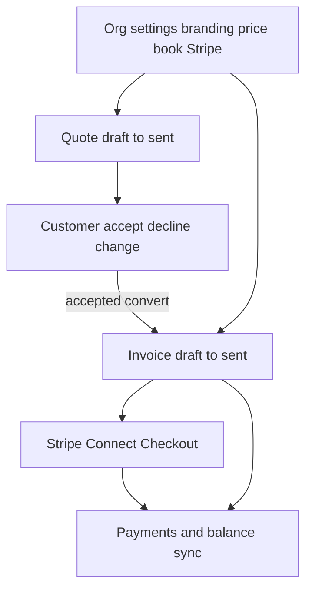

# Quotes & Invoicing — Master Implementation Guide

**Source system:** HeyTeam App (this repository)  
**Audience:** An AI coding agent implementing the same product behaviour in a **different** application  
**Scope:** Quotes, invoices, price book, branding/settings, customer interactions, Stripe Connect payments, PDFs, email, chasing  
**Out of scope:** Full Job Management workflow (document only the quote↔job **boundary**)  
**Rule:** Documentation only — no secrets, no invented features. Gaps are labelled **Confirmed gap** or **Unclear**.

---

## 1. System overview

HeyTeam’s Quotes & Invoicing module is an **organisation-scoped document system**:

1. Admins configure branding, price book, terms, email templates, payment terms, invoice chasing, and Stripe Connect.
2. Admins create **quotes** (line items, VAT, discounts) → send to customers via email + share link → customers accept / decline / request change.
3. Accepted quotes convert to **draft invoices** (or invoices are created manually).
4. Advoices are sent with optional **Stripe Checkout** on the org’s **connected Stripe account** (direct charges).
5. Payments (Stripe or manual) update invoice balance and status; PDFs and emails support the lifecycle.

Money is stored in **minor units** (`*Pence`). Currency is snapshotted per document (`GBP` | `USD` | `EUR`). Statuses are **string constants**, not DB enums.

---

## 2. Architecture (portable contracts)

| Layer | Responsibility | HeyTeam reference |
| --- | --- | --- |
| Schema | Tables for docs, lines, payments, settings, share tokens | `shared/schema.ts` |
| Constants | Units, VAT rates, line types, statuses | `shared/price-book-constants.ts`, schema const arrays |
| Line math | Compute line + header totals on write | `server/quote-routes.ts` `computeLine`; `server/lib/invoice-totals.ts` |
| Lifecycle | Allowed status transitions | `server/lib/quote-lifecycle.ts`, `invoice-lifecycle.ts` |
| HTTP API | Admin CRUD + public token + portal | `quote-routes.ts`, `invoice-routes.ts`, `quote-invoice-settings-routes.ts`, `customer-portal-billing.ts` |
| Stripe | Connect OAuth + Checkout on connected account | `quote-invoice-stripe-connect.ts`, `stripe-invoice-documents.ts` |
| PDF / email | Render PDF, send templated email | `quote-pdf.ts`, `invoice-pdf.ts`, `server/email.ts` |
| UI | Builders, lists, settings, public/portal views | `client/src/pages/billing-*.tsx`, `components/quote-invoice/` |

Target apps may use different frameworks; preserve **data contracts, formulas, transitions, and API semantics**.

---

## 3. Phase index (implement in order)

| Phase | File | Focus | Depends on |
| --- | --- | --- | --- |
| 00 | This guide | Strategy + checklist | — |
| 01 | `01_DATA_MODELS_AND_SCHEMA.md` | Tables, FKs, statuses, money | — |
| 02 | `02_ORG_SETTINGS_BRANDING_PRICE_BOOK.md` | Branding, terms, price book, chase settings APIs/UI | 01 |
| 03 | `03_LINE_ITEMS_PRICING_TAX_CALCULATIONS.md` | Line/header math, VAT asymmetry, validation | 01 |
| 04 | `04_QUOTE_LIFECYCLE_AND_APIS.md` | Quote CRUD, send, versioning, convert | 01–03 |
| 05 | `05_QUOTE_BUILDER_UI.md` | Manager quote list/builder/detail | 02–04 |
| 06 | `06_CUSTOMER_QUOTE_INTERACTIONS.md` | Public token + portal accept/decline/change | 04 |
| 07 | `07_INVOICE_LIFECYCLE_AND_APIS.md` | Invoice CRUD, payments, void, credit notes | 01–03, 04 |
| 08 | `08_INVOICE_UI_AND_CHASING.md` | Invoice UI + chasing | 02, 07 |
| 09 | `09_STRIPE_CONNECT_AND_PAYMENTS.md` | Connect, Checkout, webhooks, refunds | 02, 07 |
| 10 | `10_PDF_EMAIL_NOTIFICATIONS.md` | PDF, email templates, delivery | 04–09 |
| 11 | `11_INTEGRATION_BOUNDARIES_AND_E2E_VERIFICATION.md` | Job boundary, widget note, E2E checklist | All |

Give the target agent **one phase file at a time**. Do not skip ahead of dependencies.

---

## 4. Prerequisites before Phase 01

- Multi-tenant **organisation** + authenticated **admin/team** users.
- **Customers** entity (quotes may have nullable client; invoices require client).
- File storage for logos, attachments, PDFs.
- Env (names illustrative — never commit secrets):
  - Platform Stripe secret key
  - `STRIPE_CONNECT_CLIENT_ID`
  - `STRIPE_WEBHOOK_SECRET` / `STRIPE_CONNECT_WEBHOOK_SECRET`
  - Public app base URL for share links and OAuth redirects
- Email provider for quote/invoice send.

HeyTeam migrations (reference only): `066`–`069`, `071`–`072`, `094`, `102`–`103`, `134`–`137` under `migrations/`.

---

## 5. End-to-end happy path (product)

1. Connect Stripe (org settings) and enable payment links when charges are ready.
2. Create price book items; set branding + default quote expiry + terms.
3. Create quote with ≥1 valid line → Save draft → Send.
4. Customer opens `/quote/:token` → Accept.
5. Admin Convert to invoice → Send invoice (Checkout URL if Connect ready).
6. Customer pays → webhook/reconcile records payment → invoice `paid`.
7. Optional: chase unpaid invoices; record manual payments; void; credit note after paid.

---

## 6. Known asymmetries / gaps (do not “fix” silently in the target unless intended)

| Item | Confirmed behaviour |
| --- | --- |
| Quote VAT | Only `standard_20` → 20%; other rates → 0 tax on quotes |
| Invoice VAT | `standard_20` → 20%; `reduced` → 5%; else 0 |
| Line-level discount UI | Schema supports it; quote/invoice builder UI does not expose it (defaults `none`) |
| Portal Checkout metadata | Portal `buildStripeMetadata` omits `heyteam_document`; reconcile expects `heyteam_document === "invoice"` — **Confirmed gap** for portal-created sessions |
| Platform fee | No `application_fee_amount` on invoice Checkout |
| Quote reminders | No reminder API on billing quotes (separate legacy quotation module exists) |
| Archive quote | Sets archived without always calling transition helper |

---

## 7. Overall verification checklist

- [ ] Schema matches Phase 01 contracts (money in minor units, statuses).
- [ ] Settings + price book CRUD works (Phase 02).
- [ ] Line totals match formulas (Phase 03) for quote and invoice cases.
- [ ] Quote draft → send → public accept → convert (Phases 04–06).
- [ ] Invoice draft → send → manual payment → paid (Phases 07–08).
- [ ] Stripe Connect Checkout + webhook/refund path (Phase 09).
- [ ] PDF attach + email on send (Phase 10).
- [ ] Job link is optional boundary only (Phase 11).

---

## 8. Source map (HeyTeam)

| Area | Paths |
| --- | --- |
| Schema | `shared/schema.ts`, `shared/price-book-constants.ts`, `shared/document-line-schema.ts` |
| Quotes API | `server/quote-routes.ts`, `server/lib/quote-lifecycle.ts`, `server/lib/quote-pdf.ts` |
| Invoices API | `server/invoice-routes.ts`, `server/lib/invoice-lifecycle.ts`, `server/lib/invoice-totals.ts`, `server/lib/invoice-pdf.ts` |
| Settings | `server/quote-invoice-settings-routes.ts` |
| Stripe | `server/lib/quote-invoice-stripe-connect.ts`, `server/lib/stripe-invoice-documents.ts`, `server/lib/stripe-connect-webhook.ts` |
| Portal | `server/lib/customer-portal-billing.ts` |
| UI | `client/src/pages/billing-quote-*.tsx`, `billing-invoice-*.tsx`, `billing-quote-invoice-settings.tsx`, `public-quote-view.tsx`, `public-invoice-view.tsx`, `client/src/components/quote-invoice/` |
